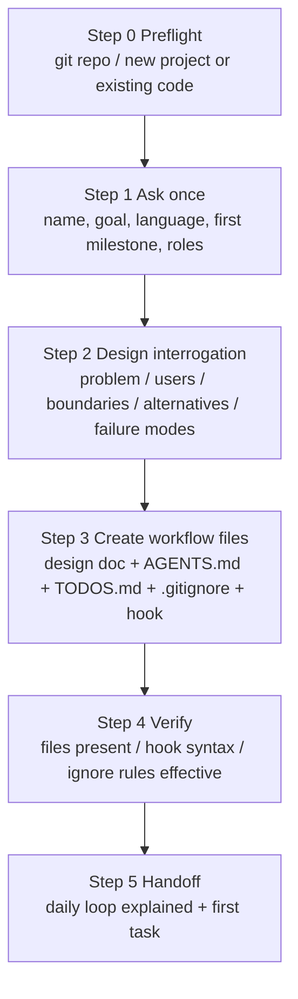

# Project Bootstrap: Initializing the Project Workflow Skeleton

Goal: turn a project from an empty directory into "workflow-ready" in a single interaction. Everything that follows is built on three living documents:

- **Design document** (single source of truth): think before building; every decision has a record;
- **AGENTS.md** (living project conventions): iron rules, facts, and a pitfall log—so the AI does not drift during long-running collaboration;
- **TODOS.md** (single task list): every task is a single-point item with a verification column; completion requires evidence.

Plus the **auto-commit hook** (commits automatically whenever an AI session goes idle, with an LLM-generated commit message), so change history accumulates naturally.

## Dependencies and Fallbacks (self-contained declaration)

The core capabilities of this skill (templates, scripts, hook code) are fully self-contained in `assets/` and `scripts/`, with **no hard dependency on network or MCP**. The following are optional enhancements with automatic fallbacks:

| Dependency | Purpose | Fallback when missing |
|---|---|---|
| `grilling` / `grill-me` skill (external, optional) | Design interrogation in Step 2 | Use the built-in question list in Step 2 |
| `humanizer-zh` / `humanizer` skill (external, optional) | De-AI-flavor polish for Chinese docs | Skip polishing; self-check against the language conventions |
| `git` (required) | Version control and auto-commit | None (run `git init` first) |
| `node` (ships with opencode) | Running the auto-commit plugin | Skip hook installation; advise manual commits |
| Other skills / MCP | No dependency | — |

## Process Overview



## Step 0: Preflight

1. Confirm the working directory and project root; if not inside a git repository, run `git init` first (the auto-commit hook depends on git).
2. Determine the project shape:
   - **New project** (empty or freshly initialized): create everything in the standard flow;
   - **Existing code, no workflow docs**: create everything in the standard flow too, but add one task to TODOS.md: "**Documentation-vs-reality gap analysis**"—backfill the Overview/Architecture/Components sections of the design doc against the actual code, so docs and reality never diverge.
3. If `AGENTS.md` / `TODOS.md` / `docs/design/` already exist, do not overwrite them: **incrementally fill only what is missing**, and state at handoff which files were created and which were preserved.

## Step 1: Ask Once (Interview)

Collect all inputs in **one round of questions** (drip-feeding questions one at a time burns the user's patience). Prefer the question tool, or list everything in a single message:

1. **Project name and one-line description**: what it does and who it is for (goes into the design doc Overview and the first line of AGENTS.md);
2. **Documentation language**: default Chinese (technical docs in Chinese, code errors and logs in English—see the iron rules);
3. **First milestone**: what the first phase delivers (becomes the initial tasks in TODOS.md);
4. **Key facts**: naming conventions, environment dependencies, external systems—these go only into the "Facts you must know before implementing" section of AGENTS.md; do **not** write them into this skill or into project-agnostic docs;
5. **Documentation audience**: who will read the design doc (product/frontend/backend/ops/delivery)—this decides whether a "Reader's guide" is needed (add it for multi-role projects; skip for single-role).

## Step 2: Design Interrogation (Recommended)

If a `grilling` / `grill-me` skill is available, load it and run a round of design interrogation with the user in its style; otherwise use the built-in list below (ask one by one; write each conclusion straight back into the design doc). In non-interactive settings (dry runs, batch initialization), answer the list yourself: fill in what is certain, mark the rest as "to be designed"—never invent:

1. What problem does this solution solve? Without it, how do people do this today (status quo and pain points)?
2. Who are the users? What does their day look like? Give 2 concrete usage scenarios (the more specific the better, e.g. "a team wants to add an X").
3. What is the minimum viable version? **What will we explicitly not do** (capability boundaries)?
4. What are the obvious alternatives? Why not use them?
5. How does it fail in the worst case? What is the failure domain and the fallback?

> Why this step matters: the most expensive mistake in a design doc is a wrong direction—code mistakes can be fixed, but a wrong direction means starting over. Interrogation kills direction mistakes at the cheapest possible stage: the document.

## Step 3: Create the Workflow Files (Core Step)

Create each item below in order. **All templates live in `assets/templates/`** and use placeholders (`{{...}}`) marking what to fill in from the interview.

| # | Target file | Source template | Filling notes |
|---|---|---|---|
| 1 | `docs/template/tech-design-template.md` | `assets/templates/tech-design-template.md` | Copy verbatim (the template is part of the repo; it anchors the format of all future design docs) |
| 2 | `docs/design/tech-design.md` | same template | Fill Overview, User Story, Design Goals / Capability Boundaries; put interrogation conclusions under Alternatives; keep the template's placeholder comments for sections not yet designed (do not invent content) |
| 3 | `AGENTS.md` | `assets/templates/AGENTS.md.template` | Fill in the project name and one-liner; "Facts you must know" gets the constraints from Step 1; seed the pitfall log with 1–2 generic entries (e.g. "secrets never enter the repo"); one entry per real pitfall after that |
| 4 | `TODOS.md` | `assets/templates/TODOS.md.template` | Initial tasks = this skill's M0 (workflow files created; mark done when finished) + the first milestone as 3–7 coarse tasks (split finer later) |
| 5 | `.gitignore` | `assets/templates/gitignore.template` | Keep the generic section; extend per tech stack (the template has section guidance); **secrets and env files must be covered**—this is the only defense line for auto-commit |
| 6 | `.opencode/plugins/auto-commit.js` | `assets/templates/auto-commit.js` | Copy verbatim (a self-contained opencode plugin) |
| 7 | `.opencode/.gitignore` | `assets/templates/opencode-gitignore.template` | Copy verbatim (ignores opencode local artifacts; `!.gitignore` and `!plugins/` keep the ignore file itself and the plugin tracked—without them a fresh clone loses the ignore rules) |

Details per file:

### Design documents (three layers)

- **Template**: `docs/template/tech-design-template.md` is the format anchor; no design doc may deviate from its section structure;
- **Instance**: `docs/design/tech-design.md` is the single source of truth—when code and doc conflict, the doc wins; every future feature or technical decision change **edits the doc first, then the code**;
- **Companion reference** (optional): if the project has a stable contract surface (API fields, config keys, protocols), add a `docs/design/*-reference.md` with per-field reference and link it from the main doc. New projects do not need one on day one.

### The six sections of AGENTS.md

1. **First line**: project name + one-liner + current phase (one sentence is enough);
2. **Iron rules**: see the template—docs first / single TODO list / language conventions / comments explain "why" only. **Do not trim these**—they are the constitution of the whole workflow;
3. **Git and auto-commit**: commit message conventions + hook behavior + the `.gitignore` defense-line reminder;
4. **Single source of truth**: where the design doc lives and the requirement to validate examples (examples are part of the contract);
5. **Facts you must know before implementing**: project-specific naming/environment/architecture constraints—the **pitfall write-back zone**, appended continuously as the project evolves;
6. **Common pitfalls**: one entry per real pitfall, written as "symptom + how to avoid".

### The discipline of TODOS.md

- Columns: `ID | Task | Status | Verification`—**the verification column is the soul**: a task without a verification standard may not start ("what is the evidence of completion" being unanswerable means the task is not decomposed yet);
- Exactly three statuses: `todo` / `in_progress` (only one globally) / `done` (only after code is complete and tests pass);
- Granularity: one item per single-point feature (e.g. do not write "implement the user module"; write "user registration endpoint / password hashing / email verification / login endpoint" as separate items);
- Open questions go into the list too (separate section), or they will be forgotten.

### The auto-commit hook

- Behavior: on every opencode **session idle**, it runs `git add -A` → collects the diff → uses an internal LLM session to generate a conventional-commit message → commits (**commit only, never push**); on generation failure it falls back to a default message without blocking;
- Depends on: the opencode runtime (`$`, `client`, session API) + git; no external packages;
- After installing, remind the user: **`.gitignore` is the only defense line against secrets entering the repo**—the hook stages untracked files automatically, so `.env`, keys, and build artifacts must be confirmed ignored first.

## Step 4: Verify

Run the bundled script (checks file presence, hook syntax, and key `.gitignore` coverage):

```bash
bash scripts/verify-setup.sh <project-root>
```

Manual checks beyond the script:

- `git status --short`: confirm `node_modules/`, build artifacts, `.env` etc. are not tracked;
- **No `{{...}}` placeholders remain** in the three workflow documents—unknown information becomes the literal text "to be designed" (placeholders flow into the future; "to be designed" is an explicit promise);
- If the docs contain YAML/JSON/mermaid code blocks, validate their syntax (e.g. extract the blocks from Markdown and validate each one; `python3 -c "import yaml; list(yaml.safe_load_all(open('x.yaml')))"` only applies to pure YAML files).

## Step 5: Handoff

Tell the user three things:

1. **The daily loop** (paste it into the handoff message):

   ```
   ① Decisions form in conversation → ② written into the design doc (single source of truth)
   → ③ decomposed into fine-grained TODOs (with verification column)
   → ④ implement + verify item by item → ⑤ write back status and lessons (TODOS / AGENTS pitfall log)
   ```

2. **The first action**: fill the "to be designed" placeholders in the design doc (or start the first TODOS task, setting it `in_progress` before starting);
3. **Two habits**: write back to AGENTS.md the moment a pitfall is hit; never call anything "done" before it passes its verification column.

## Daily Operation Cheat Sheet

- New feature: edit the design doc first → edit TODOS (set `in_progress`) → implement → verify → mark `done`;
- Design evolution: keep a version change log (v0.1 → v0.2 …); for big revisions, first produce a "review edition" (strictly additive, key decisions highlighted, reading paths per role), then merge it back into the single doc after review;
- When docs and code diverge: run an explicit "gap analysis" and turn each gap into a TODO; never let the doc drift;
- Periodically re-check the facts section of AGENTS.md for staleness (phrases like "done / not started yet" expire the fastest).

## Detailed Methodology

Why the process works, the full lifecycle, mechanism details, and a reusable checklist live in `references/process-guide.md`. Read it when the user wants to understand the process or introduce it to a team.
